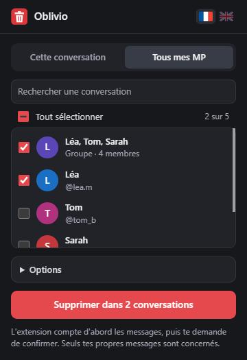
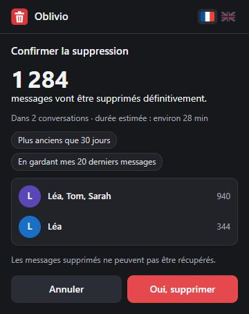
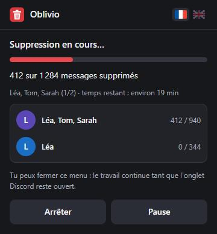

# Oblivio

**Nettoyeur de messages pour Discord.** · [English version](README.md)

Oblivio est une extension pour Chrome et Brave qui supprime **tes propres messages** Discord : dans la conversation ouverte, ou dans plusieurs messages privés d'un coup. L'interface existe en français et en anglais.

Tout se passe dans ton navigateur. L'extension ne parle qu'à `discord.com` : aucun serveur tiers, aucune collecte de données.

> **Avertissement.** Les conditions d'utilisation de Discord n'autorisent pas l'automatisation d'un compte utilisateur. L'extension travaille volontairement lentement, mais tu l'utilises à tes risques. Ce projet n'est ni affilié à Discord, ni approuvé par Discord.

  
  
  

## Fonctionnalités

- **Cette conversation** : nettoie le message privé, le groupe ou le salon ouvert dans Discord.
- **Tous mes MP** : liste tes conversations privées et groupes, avec recherche, cases à cocher et « Tout sélectionner ». Elles sont traitées l'une après l'autre.
- **Filtres** :
  - période : plus anciens que X jours, ou entre deux dates ;
  - seulement les messages contenant un mot ;
  - seulement les messages avec pièce jointe ou lien ;
  - garder tes N derniers messages de chaque conversation.
- **Aperçu avant suppression** : une analyse compte d'abord les messages concernés et estime la durée. Rien n'est supprimé avant ta confirmation.
- **Contrôle pendant la suppression** : pause, reprise, arrêt, temps restant, notification à la fin.
- Un encart dans la page Discord affiche l'avancement, même quand le menu de l'extension est fermé.
- **Français / anglais** : change de langue avec les drapeaux en haut du menu.

## Installation

L'extension se charge en local, en mode développeur.

1. Télécharge ce dépôt (bouton **Code** puis **Download ZIP**) et décompresse-le dans un dossier qui ne bougera plus.
2. Ouvre `chrome://extensions` (ou `brave://extensions`).
3. Active le **Mode développeur**, en haut à droite.
4. Clique sur **Charger l'extension non empaquetée**.
5. Choisis le dossier qui contient `manifest.json`.

Pour mettre à jour : remplace les fichiers du dossier, clique sur la flèche de rechargement de l'extension dans `chrome://extensions`, puis recharge la page Discord.

## Utilisation

1. Ouvre [discord.com/app](https://discord.com/app) dans le navigateur (pas l'application de bureau).
2. Clique sur l'icône de l'extension.
3. Choisis l'onglet **Cette conversation** ou **Tous mes MP**, et règle les options si besoin.
4. Clique sur **Supprimer mes messages**. L'extension analyse et affiche le nombre exact de messages concernés.
5. Confirme avec **Oui, supprimer**, ou annule.

Laisse l'onglet Discord ouvert jusqu'à la fin.

## Limites

- Seuls **tes** messages sont supprimés, jamais ceux des autres.
- La suppression est **définitive**.
- Compte environ **1 message par seconde** : c'est le rythme que Discord tolère. 1 000 messages prennent une vingtaine de minutes.
- L'analyse parcourt toute la conversation et peut prendre quelques minutes sur un très long historique.
- « Tous mes MP » ne montre que les conversations encore présentes dans ta liste Discord. Celles que tu as fermées n'apparaissent pas.
- Les lignes système (appels, ajout d'un membre à un groupe, etc.) ne peuvent pas être supprimées.
- Si l'extension affiche « Session Discord introuvable », recharge la page Discord (F5) et réessaie.

## Fonctionnement

L'extension réutilise la session Discord déjà ouverte dans l'onglet et appelle l'API de Discord :

| Appel | Rôle |
| --- | --- |
| `GET /users/@me` | savoir quel compte est connecté |
| `GET /users/@me/channels` | lister les conversations privées et groupes |
| `GET /channels/{id}/messages` | parcourir une conversation, 100 messages à la fois |
| `DELETE /channels/{id}/messages/{id}` | supprimer un message |

Quand Discord demande de ralentir (réponse `429`), l'extension attend le délai indiqué, puis espace davantage ses demandes.

### Autorisations demandées

| Autorisation | Pourquoi |
| --- | --- |
| `https://discord.com/*` | agir dans l'onglet Discord et appeler son API |
| `scripting`, `activeTab` | injecter le script de nettoyage dans l'onglet Discord |
| `webRequest` | méthode de secours pour retrouver la session ouverte |
| `storage` | retenir la langue, et les options tant que le navigateur est ouvert |
| `notifications` | prévenir quand la suppression est terminée |

### Fichiers

| Fichier | Rôle |
| --- | --- |
| `manifest.json`, `_locales/` | déclaration de l'extension (Manifest V3) et son nom dans les deux langues |
| `popup.html`, `popup.css`, `popup.js` | le menu de l'extension |
| `content.js` | le moteur : analyse, filtres, suppression, encart dans Discord |
| `shared.js` | textes français et anglais |
| `background.js` | session de secours et notification de fin |
| `icons/` | icônes de l'extension |
| `docs/` | captures d'écran de ce README |

Aucune dépendance, aucune étape de compilation : le dépôt se charge tel quel.

## Licence

[MIT](LICENSE) © ESO
