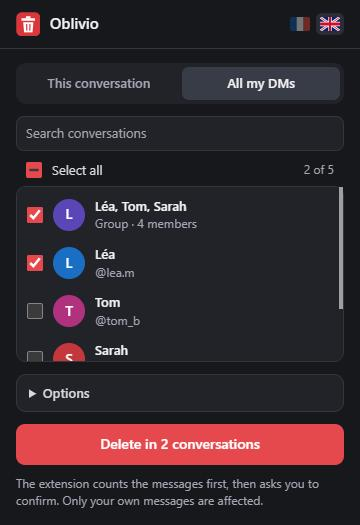
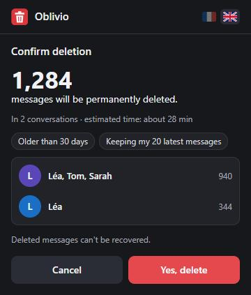
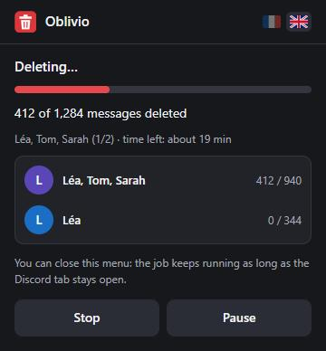

# Oblivio

**Message cleaner for Discord.** · [Version française](README.fr.md)

Oblivio is a Chrome and Brave extension that deletes **your own** Discord messages: in the open conversation, or across several DMs at once. The interface is available in English and French.

Everything happens in your browser. The extension only talks to `discord.com`: no third-party server, no data collection.

> **Warning.** Discord's Terms of Service do not allow automating a user account. The extension deliberately works slowly, but you use it at your own risk. This project is not affiliated with or endorsed by Discord.

  
  
  

## Features

- **This conversation**: cleans the DM, group chat or channel currently open in Discord.
- **All my DMs**: lists your DMs and group chats, with search, checkboxes and "Select all". They are processed one after the other.
- **Filters**:
  - period: older than X days, or between two dates;
  - only messages containing a word;
  - only messages with an attachment or a link;
  - keep your N latest messages in each conversation.
- **Preview before deleting**: a scan first counts the matching messages and estimates the duration. Nothing is deleted until you confirm.
- **Control while deleting**: pause, resume, stop, time left, and a notification when it is done.
- A small panel inside the Discord page shows progress even when the extension menu is closed.
- **English / French**: switch with the flags at the top of the menu.

## Installation

The extension is loaded locally, in developer mode.

1. Download this repository (**Code** button, then **Download ZIP**) and unzip it into a folder that will not move.
2. Open `chrome://extensions` (or `brave://extensions`).
3. Turn on **Developer mode**, top right.
4. Click **Load unpacked**.
5. Pick the folder that contains `manifest.json`.

To update: replace the files in the folder, click the reload arrow of the extension in `chrome://extensions`, then reload the Discord page.

## Usage

1. Open [discord.com/app](https://discord.com/app) in the browser (not the desktop app).
2. Click the extension icon.
3. Pick the **This conversation** or **All my DMs** tab, and set the options if needed.
4. Click **Delete my messages**. The extension scans and shows the exact number of matching messages.
5. Confirm with **Yes, delete**, or cancel.

Keep the Discord tab open until the end.

## Limits

- Only **your** messages are deleted, never anyone else's.
- Deletion is **permanent**.
- Expect about **1 message per second**: this is the pace Discord tolerates. 1,000 messages take around twenty minutes.
- The scan walks through the whole conversation and can take a few minutes on a very long history.
- "All my DMs" only shows the conversations still in your Discord DM list. The ones you closed do not appear.
- System lines (calls, a member added to a group, etc.) cannot be deleted.
- If the extension shows "Discord session not found", reload the Discord page (F5) and try again.

## How it works

The extension reuses the Discord session already open in the tab and calls the Discord API:

| Call | Purpose |
| --- | --- |
| `GET /users/@me` | find out which account is signed in |
| `GET /users/@me/channels` | list DMs and group chats |
| `GET /channels/{id}/messages` | walk through a conversation, 100 messages at a time |
| `DELETE /channels/{id}/messages/{id}` | delete one message |

When Discord asks to slow down (`429` response), the extension waits for the requested delay, then spaces out its requests further.

### Permissions

| Permission | Why |
| --- | --- |
| `https://discord.com/*` | act inside the Discord tab and call its API |
| `scripting`, `activeTab` | inject the cleaning script into the Discord tab |
| `webRequest` | fallback way to find the open session |
| `storage` | remember the language, and the options while the browser is open |
| `notifications` | tell you when the deletion is done |

### Files

| File | Role |
| --- | --- |
| `manifest.json`, `_locales/` | extension declaration (Manifest V3) and its name in both languages |
| `popup.html`, `popup.css`, `popup.js` | the extension menu |
| `content.js` | the engine: scan, filters, deletion, panel inside Discord |
| `shared.js` | English and French texts |
| `background.js` | fallback session lookup and end-of-job notification |
| `icons/` | extension icons |
| `docs/` | screenshots used in this README |

No dependencies and no build step: the repository loads as is.

## License

[MIT](LICENSE) © ESO
